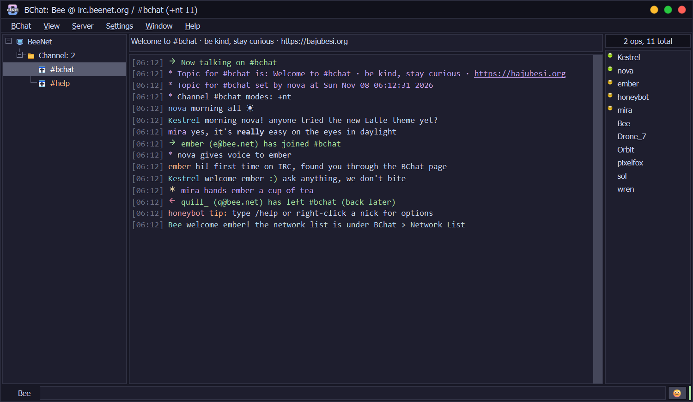
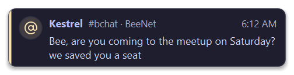

<div align="center">


### Handle IRC as a bee does a flower.

A calm, modern IRC client for Windows: the classic XChat 2 feel, safe by default, easy on day one.

[](https://github.com/fhazal/BChat/releases)
[](https://github.com/fhazal/BChat/releases)
[](LICENSE)
[](https://ko-fi.com/bajubesi)

**[Download](https://github.com/fhazal/BChat/releases)** · [Features](#features) · [Safety](#safe-by-default) · [Build from source](#build-from-source)

</div>

<br>

<p align="center">
  
</p>

## Why BChat

IRC is still one of the friendliest places on the internet to talk, but most clients look and feel like they stopped in 2005. BChat keeps what made IRC great (plain text, your own servers, no accounts, no tracking) and modernises the experience around it: a quiet interface, careful defaults, and safety built in rather than bolted on.

It is made for both sides of IRC: newcomers who have never typed `/join`, and veterans who know XChat by heart.

## Features

**The XChat you remember**
- Network tree with folders and lines, topic bar, inline chat and a nick list with glass status lights
- Network List with auto-connect, auto-join, SSL, ZNC, SASL, NickServ and proxies
- Imports your networks and nick from XChat 2 and XChat-SE
- DCC send, receive and chat, channel list, ban list, ignore list, friends, URL grabber, logs
- Text events, key bindings, spell check, character chart, detachable tabs
- Python plugins with XChat's Python interface, so most XChat 2 scripts just work

**Modern where it counts**
- Six themes: Catppuccin Mocha, Macchiato, Frappé and Latte, One Dark Pro and Dracula, all editable
- Quiet notification cards for highlights and private messages, with flood protection, and silent while you game or present
- Minimise or close to the tray, with a blinking icon for new messages
- Updates itself: signed, checked, installed when you quit
- Controls you can't use are hidden, not greyed out

## Safe by default


- **Passwords stay out of files.** Network, SASL, NickServ and proxy passwords live in Windows Credential Manager, not in BChat's settings.
- **Certificates are checked.** A bad or changed server certificate gets a clear question with its fingerprint. Trust it once or always, and BChat warns you if it ever changes.
- **Risky links ask first.** Program downloads, look-alike names and raw IP links show where they lead before they open. Normal links still open with one click.
- **DCC files are handled carefully.** Programs never download by themselves, hidden right-to-left tricks are stripped from file names, and received files are marked as from the internet so Windows checks them before they run.
- **Updates are signed.** Every installer is verified with BChat's own key before it runs.

<br clear="right">

## Themes

<p align="center">
  
</p>

<p align="center">
  
</p>

## Install

The first installer is on its way. Until then you can [build from source](#build-from-source).

1. Download `BChat-x.y.z-setup.exe` from [Releases](https://github.com/fhazal/BChat/releases).
2. Run it. Windows may show a SmartScreen notice because the installer isn't code-signed yet: choose **More info > Run anyway**.
3. Pick a network, choose a nick, and say hello.

Settings live in `%APPDATA%\BChat`.

## Build from source

Needs Python 3.11 or newer.

```bash
git clone https://github.com/fhazal/BChat.git
cd BChat
python -m pip install -e .
python -m bchat
```

Run the tests:

```bash
python -m pip install pytest
python -m pytest
```

## Credits

- Icons: [Lucide](https://lucide.dev) (ISC), coloured from the theme
- Themes: [Catppuccin](https://catppuccin.com), [One Dark Pro](https://github.com/Binaryify/OneDark-Pro) and [Dracula](https://draculatheme.com) (MIT)
- Inspired by [XChat](http://xchat.org) 2, the client many of us grew up with
- The BChat logo, bee and nick list lights are BChat's own

## Support

BChat is free and has no ads. If it makes IRC better for you, you can support its development:

<a href="https://ko-fi.com/bajubesi"></a>

## Licence

GPL-2.0-or-later, see [LICENSE](LICENSE). Made by **BajuBesi Labs** · [bajubesi.org](https://bajubesi.org)
