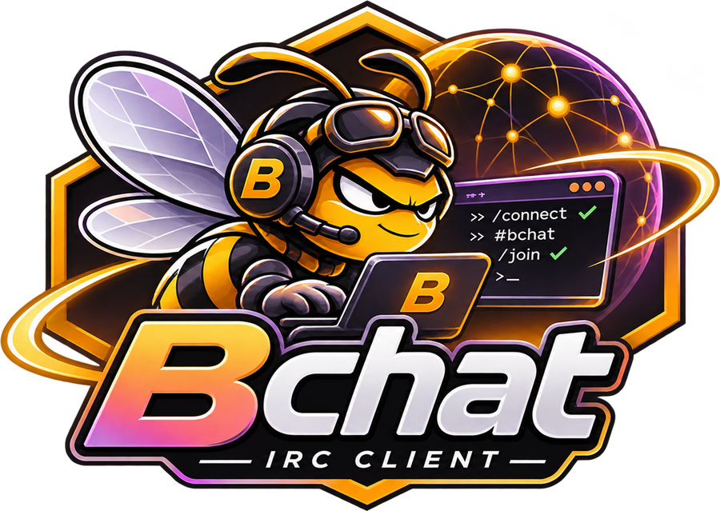
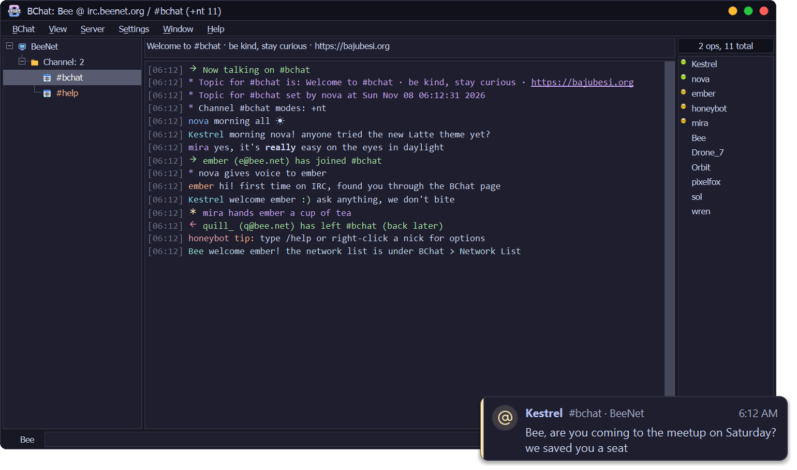
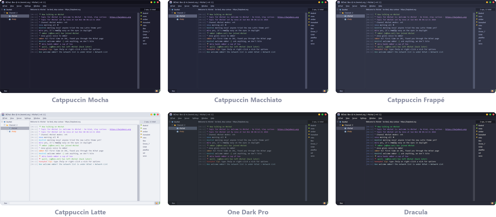
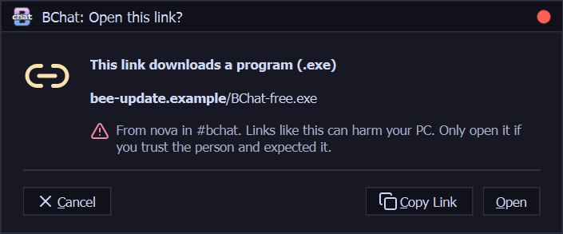

<div align="center">



<h1>
  <picture>
    <source media="(prefers-color-scheme: dark)" srcset="assets/logo/beehex/wordmark-dark-180.png">
    <source media="(prefers-color-scheme: light)" srcset="assets/logo/beehex/wordmark-light-180.png">
    
  </picture>
</h1>

**Handle IRC as a bee does a flower. A calm, modern IRC client for Windows, made by BajuBesi Labs.**
Classic XChat feel · six themes · safe by default · notification cards · Python plugins


[](LICENSE)

-41cd52?logo=qt&logoColor=white)
[](https://github.com/fhazal/BChat/releases/latest)
[](https://www.virustotal.com/gui/file/d4f4a7f211f40adb1a522fc0d01e15564f26eef64c0682136170ef878b1eb591)

[](https://bajubesi.org)
[](https://ko-fi.com/bajubesi)

</div>

> [!NOTE]
> BChat is a free, open-source IRC client by **BajuBesi Labs**. No accounts, no ads, no tracking: it talks only to the IRC networks you choose, plus GitHub once a day to look for updates (you can switch that off).

<p align="center">
  
</p>

---

## 🆕 What's new in 0.4.0

- 🔌 **Bouncer detection**: BChat knows when it's talking to ZNC, soju or psyBNC and says so once. What ZNC plays back shows under one grey line with the times it was really said, then *Now live*, so nothing shows twice. Hover the network to see the bouncer and how long you've been online.
- 🔑 **Log in with a certificate** (SASL EXTERNAL): no password stored or sent. *Make New* makes one on your PC, *Add to NickServ* registers it, and BChat logs in with it from then on.
- 🛡️ **ChanServ Access** in the nick menu: give someone auto-op (@) or auto-voice (+), or take it away, without typing services commands. BChat shows what they have now and the exact line it sends (Anope and Atheme).
- 🤫 **Skip the server's welcome message** and **short join and part lines**, both off until you turn them on.
- ⌨️ `/partall` leaves every channel at once, `/online` shows how long you've been connected, `/motd` shows the welcome message any time.

---

## 🎨 Seventeen themes

<p align="center">
  
</p>

**Dark:** Catppuccin **Mocha** (the default), **Macchiato** and **Frappé**, **One Dark Pro**, **Dracula**, **Tokyo Night**, **Nord**, **Gruvbox Dark**, **Rosé Pine** and **Solarized Dark**.<br>
**Light:** Catppuccin **Latte**, **Tokyo Night Light**, **Gruvbox Light**, **Rosé Pine Dawn**, **Solarized Light**, and two for old hands: **XChat Classic** and **mIRC Modern**.

Pick one in *Settings → Preferences → Colors*, change any colour you like, and *Reset to Theme* whenever you want to start over. Icons follow the theme too.

---

## ✨ Features

<table>
<tr>
<td width="50%" valign="top">

### 💬 The XChat you remember
A network tree with folders and dotted lines, a topic bar, inline chat and a nick list with glass status lights. Detach any tab into its own window, search the text, keep a marker line where you left off, and pick emoji for your messages and topics. XChat 2 and XChat-SE users can bring their networks and nick across on first start.

</td>
<td width="50%" valign="top">

### 🌐 Networks and servers
A Network List with auto-connect and auto-join, SSL/TLS, SASL, certificate login, NickServ, ZNC and soju bouncers, and proxies. Open a quick `/server` tab and save it as a network later; the tree updates straight away. New to IRC? The welcome screen on first start has you pick a nickname and a network, and you're talking.

</td>
</tr>
<tr>
<td valign="top">

### 🔒 Safe by default
Passwords live in **Windows Credential Manager**, not in a settings file. Server certificates are checked, and risky links ask before they open. Read more in [Safety](#-safety).

</td>
<td valign="top">

### 🔔 Notification cards
A small themed card above the taskbar when someone highlights you or sends a private message. Click it to jump to that chat. Floods turn into one summary card, and nothing pops up while you game, present or use Focus.

</td>
</tr>
<tr>
<td valign="top">

### 📁 DCC files and chats
Send and receive files and direct chats, with a File Transfers window. Programs never download by themselves, and every received file is marked as coming from the internet, so Windows checks it before it runs.

</td>
<td valign="top">

### 🧩 Python plugins
XChat's Python interface, so most XChat 2 scripts just work. Drop them in the `addons` folder or load them from *Window → Plugins and Scripts*. Text events and key bindings can be changed too.

</td>
</tr>
<tr>
<td valign="top">

### 🗂️ Tools you'll use
Channel List, Channel Central, Ignore List, Friends (notify), Address Book, URL Grabber, character chart, spell check while you type, daily logs with a Logs window to search them, and scrollback for every chat.

</td>
<td valign="top">

### 🔄 Updates itself
When a new version is out, a quiet *Update* entry appears after *Help*. BChat downloads it, checks its signature, and installs it when you quit. TEST versions only if you ask for them.

</td>
</tr>
</table>

<details>
<summary><b>Default shortcuts</b></summary>

| Action | Keys |
| --- | --- |
| Network List | `Ctrl+S` |
| New server tab | `Ctrl+T` |
| Close tab | `Ctrl+W` |
| Detach tab | `Ctrl+I` |
| Search text | `Ctrl+F` |
| Bold, underline, italic, reverse, strikethrough (input box; wraps selected text) | `Ctrl+B` `Ctrl+U` `Ctrl+Shift+I` `Ctrl+R` `Ctrl+E` |
| Colour, back to normal (input box) | `Ctrl+K` `Ctrl+O` |
| Clear text | `Ctrl+L` |
| Reset marker line | `Ctrl+M` |
| Marked away | `Alt+A` |
| Show / hide the user list | `Ctrl+F7` |
| Show / hide the menu bar | `Ctrl+F9` |
| Help | `F1` |
| Quit | `Ctrl+Q` |

All of them can be changed in *Settings → Advanced → Keyboard Shortcuts*.

</details>

---

## 🔒 Safety

<table>
<tr>
<td width="55%" valign="top">

- **Passwords stay out of files.** Network, SASL, NickServ and proxy passwords are kept in Windows Credential Manager. Older settings move there by themselves on the next save.
- **Log in without a password.** With a certificate (SASL EXTERNAL) nothing secret is stored or sent; its private key never leaves your PC.
- **Certificates are checked.** A bad or changed certificate gets a clear question with its fingerprint: *Don't Connect*, *Connect Once* or *Always Trust*. If a trusted certificate ever changes, BChat warns you.
- **Risky links ask first.** Program downloads, look-alike names and bare IP links show where they lead before they open. Normal links still open with one click.
- **DCC tricks are stripped.** Hidden right-to-left characters that disguise `photo.exe` as a picture are removed from file names, and programs need your OK.
- **Updates are signed.** Every installer is verified with BajuBesi Labs' own key before it runs.

</td>
<td width="45%" align="center" valign="top">
<br>
<b>Risky link</b> · shows where it goes, Cancel is the default
</td>
</tr>
</table>

---

## 🚀 Install

1. Download the latest installer (`BChat-…-setup.exe`) from **[Releases](https://github.com/fhazal/BChat/releases/latest)** and run it. It isn't code-signed yet, so Windows SmartScreen may warn you: choose **More info → Run anyway**.
2. Start BChat, pick a network from the Network List (or add your own), choose a nick, and say hello.

> [!TIP]
> BChat **updates itself**: when a new version is out, an *Update* entry appears after *Help*. It only installs updates signed by us, and your settings, networks and logs are kept. To update by hand, run the new installer over the top.

### Antivirus

The 0.4.0 installer was checked by [VirusTotal](https://www.virustotal.com/gui/file/d4f4a7f211f40adb1a522fc0d01e15564f26eef64c0682136170ef878b1eb591): none of the 66 antivirus engines that scanned it flagged it. Because the installer isn't code-signed yet, some antivirus programs may still stop it or the self-update. Either run the installer yourself, or add BChat's install folder as an exception in your antivirus.

---

## 🔐 Privacy

BChat connects only to the IRC networks you add, and to GitHub to look for updates (*Settings → Preferences → General → Updates* turns that off). A problem report goes to bajubesi.org only when you press **Send**, after showing you what's in it (names and addresses replaced, no chat text). It sends nothing about you anywhere else. Like any IRC client, the networks you join can see your IP address unless you use a bouncer or proxy.

<details>
<summary><b>Where things live on your PC</b></summary>

`%APPDATA%\BChat\`

| Path | What it is |
| --- | --- |
| `config.json` | Your settings and networks (no passwords) |
| `logs\` | Chat logs when logging is on: `Network\#channel\2026-11-09.log`, one file a day |
| `reports\` | A problem report waiting to be sent, and the last crash's note |
| `scrollback\` | Recent lines shown again when you reopen a chat |
| `addons\` | Python plugins that load at start |
| `downloads\` | Files received over DCC (changeable in Preferences) |
| `updates\` | A downloaded update waiting to install |

Passwords are in **Windows Credential Manager** under entries named `BChat:…`.

</details>

---

## 🛠️ Building

<details>
<summary><b>Project layout and build steps</b></summary>

| Path | What it is |
| --- | --- |
| `bchat/` | The app: main window, IRC sessions, chat view, dialogs, plugins, updater |
| `bchat/assets/` | Icons, Lucide SVGs, the bee and logo pictures |
| `tests/` | Tests, with a fake IRC server for real end-to-end runs |
| `packaging/` | PyInstaller entry point, Inno Setup script and the logo/installer art builders |
| `assets/` | Logo masters and artwork |

Needs Windows 10/11 and Python 3.11 or newer.

```powershell
git clone https://github.com/fhazal/BChat.git
cd BChat
python -m pip install -e .
python -m bchat               # run from source
python -m pip install pytest
python -m pytest              # all tests
```

The installer is built with [PyInstaller](https://pyinstaller.org) and [Inno Setup 6](https://jrsoftware.org/isinfo.php) (`packaging/bchat.iss`).

</details>

---

## 🗺️ Roadmap

- 🔌 soju: list the networks inside your bouncer in the Network List
- 🧭 More of what veterans expect from the big clients, kept out of the newcomer's way
- 🏷️ Nick list rank icons
- ✍️ A code-signed installer, so Windows and antivirus programs trust it straight away

---

## 🙏 Credits

- **[XChat](http://xchat.org) 2**, the client many of us grew up with: BChat's layout and feature set follow it.
- **[Lucide](https://lucide.dev)** (ISC licence): the icon set used throughout BChat.
- **[Catppuccin](https://catppuccin.com)**, **[One Dark Pro](https://github.com/Binaryify/OneDark-Pro)**, **[Dracula](https://draculatheme.com)**, **[Tokyo Night](https://github.com/enkia/tokyo-night-vscode-theme)**, **[Nord](https://www.nordtheme.com)**, **[Gruvbox](https://github.com/morhetz/gruvbox)**, **[Rosé Pine](https://rosepinetheme.com)** and **[Solarized](https://ethanschoonover.com/solarized/)** (MIT): the colour themes. *XChat Classic* uses XChat 2's own colours (GPL); *mIRC Modern* follows mIRC's colour scheme of that name.
- **[Qt for Python (PySide6)](https://doc.qt.io/qtforpython-6/)**: the toolkit BChat is built on.
- The BChat logo, the bee and the nick list lights are BChat's own.
- Released under the [GPL-2.0-or-later licence](LICENSE).

## ☕ Support

BChat is free and has no ads. If it makes IRC better for you, you can support its development:

<a href="https://ko-fi.com/bajubesi"></a>

<div align="center">

<sub>Made with ☕ by <b>BajuBesi Labs</b> · BChat is inspired by XChat 2 and is not affiliated with the XChat project.</sub>

</div>
