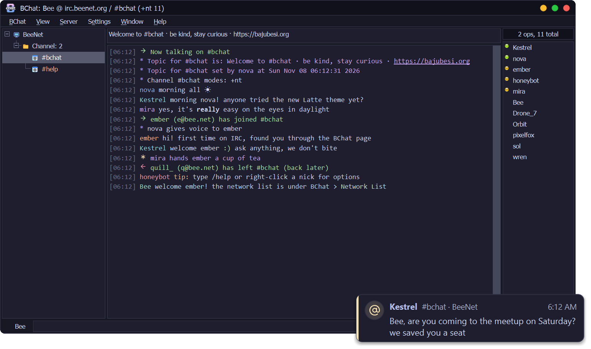
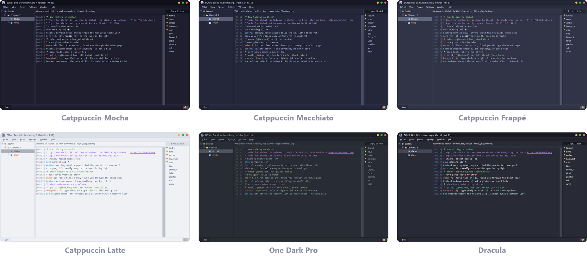
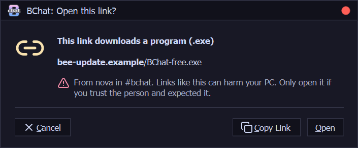

<div align="center">


<h1>
  <picture>
    <source media="(prefers-color-scheme: dark)" srcset="assets/logo/beehex/wordmark-dark-180.png">
    <source media="(prefers-color-scheme: light)" srcset="assets/logo/beehex/wordmark-light-180.png">
    
  </picture>
</h1>

**Handle IRC as a bee does a flower. A calm, modern IRC client for Windows and Linux, made by BajuBesi Labs.**
Classic XChat feel · seventeen themes · safe by default · notification cards · Python plugins


[](LICENSE)

-41cd52?logo=qt&logoColor=white)
[](https://github.com/fhazal/BChat/releases/latest)

[](https://bajubesi.org)
[](https://ko-fi.com/bajubesi)

</div>

> [!NOTE]
> BChat is a free, open-source IRC client by **BajuBesi Labs**. No accounts, no ads, no tracking: it talks only to the IRC networks you choose, plus GitHub once a day to look for updates (you can switch that off).

<p align="center">
  
</p>

---

## 🆕 What's new in 0.9.2

- 🚪 **Keep the channel tab open, or not** (*Settings → General*): *Keep the channel tab open when I'm kicked* and *Keep the channel tab open when I leave it*. Both are on, as before; turn one off and the tab closes, and the line about it goes to the server tab.
- 🩶 **Greyed-out options look greyed out**: an option you can't use right now has grey text everywhere in BChat.

<details><summary>0.9.1</summary>

- 📦 **BChat as a Flatpak**: `BChat-0.9.1.flatpak` installs BChat in its own sandbox and is updated by your software centre.
- 🐛 **Fixed**: closing a tab or window while BChat was still looking up a server name could cause an error a few seconds later.

</details>

<details><summary>0.9.0</summary>

- 🐧 **BChat comes to Linux**: one file, `BChat-x86_64.AppImage`, for Ubuntu 22.04 or newer, Fedora and other current 64-bit distros. No install and no admin password.
- 🔑 **Passwords in your desktop's keyring** (GNOME Keyring, KDE Wallet or KeePassXC), listed as *BChat IRC passwords*. If no keyring answers, BChat says so and keeps no passwords; it never writes them to a file.
- 🏠 **Feels at home**: an app menu entry, `irc://` and `ircs://` links open in BChat, and *Start when I log in* works on Linux too.
- 🎵 **`/np`, `/sysinfo` and speech on Linux**: `/np` reads any MPRIS music player, `/sysinfo` shows your distro and kernel, and *Speech* uses your desktop's voices.
- 🔄 **Updates itself on Linux**: the AppImage is replaced in place and checked against its own signature, apart from the Windows one.

</details>

<details><summary>0.8.10</summary>

- 📁 **File transfers has its own place in Settings**: *Settings → File transfers* now holds **Options** and **Trusted people**.
- 🚫 **Choose who may send you files and direct chats** (*File transfers → Options*): *File offers* and *Direct chat offers* each have Ask me, Accept from trusted people, Accept from everyone or Ignore them. An ignored offer leaves one grey line. `/sreq` and `/creq` set them too.
- 🔌 **Proxy "Not for:"** (*Settings → Network setup*): list servers that should connect directly, without the proxy.
- ⌨️ **Commands**: `/updatenl` reloads the nick list, `/queryrn old new` renames a private tab, and `/timer1 ...`, `/timer1 off` or `/timer<name>` give timers a name.

</details>

<details><summary>0.8.9</summary>

- 📤 **Passive file sends** (*Settings → File transfers → Send files*: Auto, Normal or Passive): when your router won't let the other side connect to you, the other side's client opens the connection instead. **Auto**, the default, sends passive only when it's needed. `/dcc psend` always sends passive.
- 🧹 **Lighter over time**: closed windows (Settings, Network List, About and others) are now freed instead of staying in memory until BChat quits.

</details>

<details><summary>0.8.8</summary>

- 🔎 **Find bar** (`Ctrl+F`): every match lights up as you type, `Enter` and `Shift+Enter` step through them, with match case and regular expressions. **Filter...** or `/filter word` puts the matching lines in a window of their own.
- 🪟 **Settings → Windows**: choose where events show (the active window, the server tab, the Messages tab or a private chat) and what a double-click does. `/ctcps on|off` turns CTCP replies on or off.
- 🔊 **Sound and speech** (*Settings → Sound*): sounds in .wav, .mp3 or .ogg at one volume, and BChat can read highlights, private messages and notices aloud with the voices Windows already has. `/speak text` reads a line.
- 🔌 **Router and ident** (*Settings → Network setup*, both off by default): open the file-transfer ports on your router automatically (UPnP), and answer a network's ident check while connecting. Socks4 and Socks4a proxies join Socks5 and HTTP.
- ⌨️ **Commands**: `/font` gives one window its own font, `/linesep` draws a separator, `/userhost` and `/flush` work. *Settings → Text box* can shade every other line or draw a line between messages.
- ⚙️ **Settings fit your screen**: every page scrolls inside a dialog that never grows past 85 % of the screen, Network setup shows only the rows your proxy type uses, and Preferences opens quickly.

</details>

<details><summary>0.8.6</summary>

- 💬 **One Messages tab** (*Settings → General*, off by default): all private messages on a network land in one **(messages)** tab. Reply with `/msg nick`; friends can keep their own tab.
- 🔒 **Passwords stay hidden**: NickServ, OPER, PASS and SASL passwords never show in the chat, the log, the scrollback or the Raw Log.
- 🔁 **Reconnects pick up where you were**: your away message, channel keys and connect commands come back. Channels you left stay left. A taken nick tries your alternate nick, then underscores.
- 🔑 **If the login fails** (*Network List → Edit*): BChat disconnects and doesn't retry a bad SASL or certificate login, or you can choose to stay connected.
- 🔌 **Connecting** (*Settings → Advanced*): give up after N retries, a connect time-out for silent servers, invisible mode (+i), on by default, and an option to try the server that worked first next time.
- 🌊 **Flood protection** (*Settings → Flood*): what you type goes out at once, even behind a long paste, and automatic lines are paced. `/flood` works.
- ⌨️ **Commands**: `/ban`, `/kickban` and `/ignore` take ban types 0 to 19 and look up unknown addresses. Long lines are split, not cut. Each tab keeps its own history and draft. Tab completion and **Ctrl+Tab** work better.
- 📁 **File transfers**: a **File already exists** dialog (Resume, Overwrite, Rename, Cancel), plus time-outs, a file type list and `/dcc ignore`.
- 🐝 **Bouncers**: BChat no longer reads ZNC's `*status` lines. A bouncer is treated like any other server.

</details>

<details><summary>0.8.3</summary>

- 🔌 **ZNC at the channel limit**: on a server where you were already at its channel limit, 0.8.2 showed you outside every channel after a restart, with "You have joined too many channels". BChat no longer asks the bouncer to join channels it already put you in, and that message no longer empties a tab.

</details>

<details><summary>0.8.2</summary>

- 🔑 **Joins wait for the login**: NickServ, your connect commands and your channels now go out a moment after the welcome text, and a network can wait for the NickServ login before it joins (*Network List → Edit*), so channels that need a registered nick let you in.
- 🔁 **Faster, clearer reconnects**: BChat tries again after 5 seconds and says which try it is; after 10 tries it slows to once a minute. When you're back it says how long you were gone.
- 🚫 **Kills and bans**: when an operator kills your link, BChat stays off instead of reconnecting. A server ban shows the ban text and retries once a minute.
- ⏱️ **Silent servers**: a server that stops answering is dropped after 3 minutes (*Settings → Advanced*, 1 to 10 minutes) and BChat reconnects.
- `-s` on the command line connects at once, and the saved-passwords warning no longer holds up auto-connect.

</details>

<details><summary>0.8.1</summary>

- 🔌 **ZNC: no more ghost channels**: after the IRC server restarted, a channel your bouncer couldn't get back into (an opers-only one, say) kept its old list and showed you inside, as op. BChat now hears every way ZNC says it lost the server, and when the server refuses a join, that tab empties and says so.

</details>

<details><summary>0.8.0</summary>

- 🖱️ **Your own right-click menus**: *Settings → Advanced → Popups...* has a list for the Channel, Private chat, Server tab and Nick list menus, plus a **Commands** menu in the menu bar. Your items go under BChat's own, after a line, and can use `$nick`, `$chan`, `$me`, `$1` and `|` for more than one command. Submenus and lines too.
- 📋 **Paste mIRC popups**: paste your mIRC popup text and BChat adds every line it can run. Lines it can't run are listed with the reason, never added broken.
- 🧩 **Scripts window**: *Window → Scripts...* lists your Python scripts with an on/off tick and opens them in an editor with colours, line numbers and Find. **Ctrl+S** saves and reloads; a mistake lights its line and the version that was running keeps running. **New** starts from a short example.
- 🔔 **More for scripts**: mIRC's events (`bchat.on_text`, `on_join`, `on_kick`, `on_connect` and more), menu items in any of the popups, and settings a script keeps between starts. XChat scripts still work as before.
- 🐞 **Script errors show once**, in the server tab, with an **Open in Scripts** link to the line.

</details>

<details><summary>0.7.0</summary>

- ⌨️ **31 everyday commands from mIRC**, each with `/help` text and tab completion:
  - **Talking**: `/describe` (an action to another tab), `/omsg` (only the channel's ops see it), `/qmsg` and `/qme` (every open private chat), `/ctcpreply`
  - **Your nick and name**: `/tnick` (for now), `/mnick` (saved), `/fullname`
  - **Channels**: `/autojoin` and `/perform` change this network's join list and connect commands, `/join -n` joins without switching to the tab
  - **Tabs and text**: `/clearall`, `/markasread`, `/savebuf` and `/loadbuf` (save a tab to a file, or show a file), `/strip`, `/timestamp` and `/log` for one tab, `/titlebar`
  - **People and servers**: `/dns`, `/links` (one tidy line per server), `/uwho` (the person's card), `/aop` and `/avoice` (Auto-Op & Protect), `/abook`, `/cnick` (a nick colour)
  - **Sound and files**: `/beep`, `/flash`, `/splay` (a .wav), `/play` (a text file line by line, paced so you don't flood; `/play stop`), `/run` (opens a file, folder or link; asks once before starting a program)
- 🔕 **Do not disturb**: in the tray menu or `/donotdisturb on`. No sounds, flashes, pop-up cards or tray blinking until you turn it off.
- 🎨 **Strip colours per channel**: a new tick in each tab's **Settings for #channel** menu.

</details>

<details><summary>0.6.4</summary>

- ⚡ **Busy tabs in the background cost less**: since 0.6.3 every tab has its own chat view, and tabs you weren't looking at still did scroll work for every new line. They now only add the line and scroll to the end when you open them. With many busy channels, BChat uses less CPU again, back to what 0.6.2 used or lower.

</details>

<details><summary>0.6.3</summary>

- ⚡ **Switching tabs is quick again**: every tab now has its own chat view, so clicking a channel or server no longer makes BChat lay the whole tab out again. With full tabs a switch takes about a quarter of the time it did, and busy moments (a server restart, a flood of joins and quits) run more than twice as smoothly.
- 🔌 **ZNC: a lost server shows**: when your bouncer loses the IRC server, your channels now show you as disconnected instead of still online (and still op). They fill in again when ZNC rejoins.
- 🐞 **Better problem reports**: if BChat stops responding and you close it, the next start offers a report that says where it was stuck, instead of a "crashed" report with a harmless Windows message in it.

</details>

<details><summary>0.6.2</summary>

- ⚡ **Long sessions stay quick**: once a tab held its 5000 lines, every new line made BChat lay the whole tab out again, so busy tabs got slow and the window could stutter. Old lines now go in batches: each line is about six times quicker in a full tab.
- 📍 **The marker line stays put**: in a full tab, the line that shows where you stopped reading slid further down with every new line. It now stays on its line, and if you scrolled up to read, the text no longer jumps.
- 🧹 Problem reports stay readable even when someone on your networks has a nick like *line* or *Ctrl* (names are still hidden).

</details>

<details><summary>0.6.1</summary>

- 🔑 **`//command` works the mIRC way**: `//ns identify ...` runs the command. Before, two slashes said the line as chat, so in a channel a password could go to everyone. Passwords typed to `/ns` or `/oper` are now hidden in the raw log too. To say a line that starts with `/`, use `/say`.
- 🧹 **Bug fixes**: nicks like `[x]` and `{x}` stay apart on servers that say so; *Add Network* on a `/server` tab no longer fails; Ergo servers are no longer called a bouncer; *IPv4 only* / *IPv6 only* now says when a server has only the other kind of address.
- ⚡ **No freeze on a flood of lines**: thousands of lines at once (big history, busy channel) no longer stop the window.
- 🗂️ Adding or editing a network while disconnected keeps your open channel tabs.

</details>

<details><summary>0.6.0</summary>

- 🌐 **More ways to connect**: several ports per server, tried in turn; secure WebSocket servers (`wss://`); STARTTLS; IPv4 or IPv6 only; and *don't connect at all if the VPN is off*. Turn single server features off per network.
- 🔑 **Safer logins**: SCRAM-SHA-256 whenever the server offers it, so your password is never sent.
- 🗂️ **Settings for each tab**: timestamps, nick colours, join and part lines, beep, flash, pop-up cards and logging, per channel or chat.
- 🌊 **Flood settings**: how fast BChat sends, and limits for CTCP, new private chats and WhoIs.
- 🔒 **Lock BChat** with a password (only chosen channels, no private chats or files) and a **portable mode**.
- 👥 **Friends online instantly** on WATCH servers, with away and back.
- 📁 **DCC trust list**, a richer **URL Grabber** (who, where, notes, search, kept after closing), `/ban -a` by account, start options `-s -j -n`.
- 🐝 **A quarter smaller**: installer 34 MB instead of 46 MB.

</details>

<details><summary>0.5.0</summary>

- 🛡️ **Auto-Op, Auto-Voice & Protect**: give @ or + to people by their NickServ account or address, even without ChanServ. Protect gives it back if someone takes it, and lifts bans on them. It never kicks, waits its turn behind ChanServ, and stops by itself before an op war.
- 🗂️ **Tray menu with your chats**: right-click the tray icon to see every channel and private chat, with unread counts, and jump straight in. An Away tick for every network, and BChat can now **start in the tray**.
- 🔔 **More notification cards, with a soft sound**: when you're kicked, a network drops, a friend comes online, someone invites you or offers a file. One quiet chime (or a bee buzz), at most every 10 seconds and never while you game. Choose how long cards stay.
- 👥 **Friends List extras**: how long each friend has been online, a note per friend (shared with the Address Book), and their own pop-up, sound and WhoIs.
- 🐝 **A bigger icon**: the honey tile now fills the taskbar and tray like other apps, and the title bar logo is bigger.

</details>

<details><summary>0.4.0</summary>

- 🔌 **Bouncer detection**: BChat knows when it's talking to ZNC, soju or psyBNC and says so once. What ZNC plays back shows under one grey line with the times it was really said, then *Now live*, so nothing shows twice.
- 🔑 **Log in with a certificate** (SASL EXTERNAL): no password stored or sent.
- 🛡️ **ChanServ Access** in the nick menu: auto-op (@) or auto-voice (+) without typing services commands (Anope and Atheme).
- 🤫 **Skip the server's welcome message** and **short join and part lines**; `/partall`, `/online`, `/motd`.

</details>

---

## 🎨 Seventeen themes

<p align="center">
  
</p>

**Dark:** Catppuccin **Mocha** (the default), **Macchiato** and **Frappé**, **One Dark Pro**, **Dracula**, **Tokyo Night**, **Nord**, **Gruvbox Dark**, **Rosé Pine** and **Solarized Dark**.<br>
**Light:** Catppuccin **Latte**, **Tokyo Night Light**, **Gruvbox Light**, **Rosé Pine Dawn**, **Solarized Light**, and two for old hands: **XChat Classic** and **mIRC Modern**.

Pick one in *Settings → Preferences → Colors*, change any colour you like, and *Reset to Theme* whenever you want to start over. Icons follow the theme too.

---

## ✨ Features

<table>
<tr>
<td width="50%" valign="top">

### 💬 The XChat you remember
A network tree with folders and dotted lines, a topic bar, inline chat and a nick list with glass status lights. Detach any tab into its own window, search the text, keep a marker line where you left off, and pick emoji for your messages and topics. XChat 2 and XChat-SE users can bring their networks and nick across on first start.

</td>
<td width="50%" valign="top">

### 🌐 Networks and servers
A Network List with auto-connect and auto-join, SSL/TLS and STARTTLS, secure WebSocket (`wss://`) servers, several ports per server, IPv4 or IPv6 only, SASL (SCRAM-SHA-256 too), certificate login, NickServ, ZNC and soju bouncers, and proxies. BChat can even refuse to connect while your VPN is off. Open a quick `/server` tab and save it as a network later; the tree updates straight away. New to IRC? The welcome screen on first start has you pick a nickname and a network, and you're talking.

</td>
</tr>
<tr>
<td valign="top">

### 🔒 Safe by default
Passwords live in **Windows Credential Manager**, not in a settings file. Server certificates are checked, risky links ask before they open, and you can **lock BChat** with a password or run it **portable**. Read more in [Safety](#-safety).

</td>
<td valign="top">

### 🔔 Notification cards
A small themed card above the taskbar when someone highlights you, sends a private message, kicks or invites you, or a friend comes online, with one soft chime. Click it to jump to that chat. Floods turn into one summary card, and nothing pops up or plays while you game, present or use Focus.

</td>
</tr>
<tr>
<td valign="top">

### 📁 DCC files and chats
Send and receive files and direct chats, with a File Transfers window. Programs never download by themselves, and every received file is marked as coming from the internet, so Windows checks it before it runs.

</td>
<td valign="top">

### 🧩 Python scripts and popups
XChat's Python interface, so most XChat 2 scripts just work, plus mIRC's events. Write, save and reload them in *Window → Scripts*, and add your own items to every right-click menu in *Settings → Advanced → Popups*. Text events and key bindings can be changed too.

</td>
</tr>
<tr>
<td valign="top">

### 🗂️ Tools you'll use
Channel List, Channel Central, Ignore List, Friends (notify), Address Book, URL Grabber, the everyday mIRC commands (`/autojoin`, `/perform`, `/play`, `/savebuf`, `/dns` and more), character chart, spell check while you type, daily logs with a Logs window to search them, and scrollback for every chat.

</td>
<td valign="top">

### 🔄 Updates itself
When a new version is out, a quiet *Update* entry appears after *Help*. BChat downloads it, checks its signature, and installs it when you quit. TEST versions only if you ask for them.

</td>
</tr>
</table>

<details>
<summary><b>Default shortcuts</b></summary>

| Action | Keys |
| --- | --- |
| Network List | `Ctrl+S` |
| New server tab | `Ctrl+T` |
| Close tab | `Ctrl+W` |
| Detach tab | `Ctrl+I` |
| Search text | `Ctrl+F` |
| Bold, underline, italic, reverse, strikethrough (input box; wraps selected text) | `Ctrl+B` `Ctrl+U` `Ctrl+Shift+I` `Ctrl+R` `Ctrl+E` |
| Colour, back to normal (input box) | `Ctrl+K` `Ctrl+O` |
| Clear text | `Ctrl+L` |
| Reset marker line | `Ctrl+M` |
| Marked away | `Alt+A` |
| Show / hide the user list | `Ctrl+F7` |
| Show / hide the menu bar | `Ctrl+F9` |
| Help | `F1` |
| Quit | `Ctrl+Q` |

All of them can be changed in *Settings → Advanced → Keyboard Shortcuts*.

</details>

---

## 🔒 Safety

<table>
<tr>
<td width="55%" valign="top">

- **Passwords stay out of files.** Network, SASL, NickServ and proxy passwords are kept in Windows Credential Manager, or on Linux in your desktop's keyring (GNOME Keyring, KDE Wallet, KeePassXC). Older settings move there by themselves on the next save. With no keyring, BChat keeps no passwords at all rather than writing them to a file.
- **Log in without a password.** With a certificate (SASL EXTERNAL) nothing secret is stored or sent; its private key never leaves your PC. With SCRAM-SHA-256, used whenever the server offers it, your password itself is never sent.
- **Typos don't leak passwords.** `//ns identify ...` runs the command instead of saying it in the channel, and passwords typed to `/ns` or `/oper` are hidden in the raw log.
- **Certificates are checked.** A bad or changed certificate gets a clear question with its fingerprint: *Don't Connect*, *Connect Once* or *Always Trust*. If a trusted certificate ever changes, BChat warns you.
- **Risky links ask first.** Program downloads, look-alike names and bare IP links show where they lead before they open. Normal links still open with one click.
- **DCC tricks are stripped.** Hidden right-to-left characters that disguise `photo.exe` as a picture are removed from file names, and programs need your OK.
- **Updates are signed.** Every update is verified with BajuBesi Labs' own key before it runs, and the Windows and Linux updates are signed apart, so neither can be passed off as the other.

</td>
<td width="45%" align="center" valign="top">
<br>
<b>Risky link</b> · shows where it goes, Cancel is the default
</td>
</tr>
</table>

---

## 🚀 Install

1. Download the latest installer (`BChat-…-setup.exe`) from **[Releases](https://github.com/fhazal/BChat/releases/latest)** and run it. It isn't code-signed yet, so Windows SmartScreen may warn you: choose **More info → Run anyway**.
2. Start BChat, pick a network from the Network List (or add your own), choose a nick, and say hello.

> [!TIP]
> BChat **updates itself**: when a new version is out, an *Update* entry appears after *Help*. It only installs updates signed by us, and your settings, networks and logs are kept. To update by hand, run the new installer over the top.

### Antivirus

BChat isn't code-signed yet, so some antivirus programs may stop the installer or the self-update. If yours does, either run the installer yourself, or add BChat's install folder as an exception in your antivirus. BChat is open source: everything it does is in this repository.

### Linux

BChat for Linux is one file, an **AppImage**: no install, no admin password. It runs on Ubuntu 22.04 or newer, Fedora, and other current 64-bit distros.

1. Download **`BChat-x86_64.AppImage`** from **[Releases](https://github.com/fhazal/BChat/releases/latest)**. A good home for it is `~/Applications`.
2. Make it runnable: right-click it → **Properties** → tick **Allow executing as a program** (or *Is executable*), or run `chmod +x BChat-x86_64.AppImage`.
3. Double-click it. To have it in your app menu, tick **Add BChat to the app menu** in *Settings → Preferences → General* (*Start when I log in* and opening `irc://` links are there too).

It updates itself like the Windows version: the AppImage file is replaced in place, so your menu entry and shortcuts keep working. Keep it where you can write to it (your home folder) so the update can replace it.

---

## 🔐 Privacy

BChat connects only to the IRC networks you add, and to GitHub to look for updates (*Settings → Preferences → General → Updates* turns that off). A problem report goes to bajubesi.org only when you press **Send**, after showing you what's in it (names and addresses replaced, no chat text). It sends nothing about you anywhere else. Like any IRC client, the networks you join can see your IP address unless you use a bouncer or proxy.

<details>
<summary><b>Where things live on your PC</b></summary>

`%APPDATA%\BChat\`

| Path | What it is |
| --- | --- |
| `config.json` | Your settings and networks (no passwords) |
| `logs\` | Chat logs when logging is on: `Network\#channel\2026-11-09.log`, one file a day |
| `reports\` | A problem report waiting to be sent, and the last crash's note |
| `scrollback\` | Recent lines shown again when you reopen a chat |
| `addons\` | Python plugins that load at start |
| `downloads\` | Files received over DCC (changeable in Preferences) |
| `updates\` | A downloaded update waiting to install |

Passwords are in **Windows Credential Manager** under entries named `BChat:…`.

**On Linux** the same files are in `~/.config/BChat/` (or `$XDG_CONFIG_HOME/BChat`), and passwords are in your desktop's keyring as **BChat IRC passwords**. With a file named `portable.txt` next to the AppImage, everything stays in a `BChat-data` folder beside it instead (handy on a USB stick).

</details>

---

## 🛠️ Building

<details>
<summary><b>Project layout and build steps</b></summary>

| Path | What it is |
| --- | --- |
| `bchat/` | The app: main window, IRC sessions, chat view, dialogs, plugins, updater |
| `bchat/assets/` | Icons, Lucide SVGs, the bee and logo pictures |
| `tests/` | Tests, with a fake IRC server for real end-to-end runs |
| `packaging/` | PyInstaller entry point, Inno Setup script and the logo/installer art builders |
| `assets/` | Logo masters and artwork |

Needs Windows 10/11 and Python 3.11 or newer.

```powershell
git clone https://github.com/fhazal/BChat.git
cd BChat
python -m pip install -e .
python -m bchat               # run from source
python -m pip install pytest
python -m pytest              # all tests
```

The installer is built with [PyInstaller](https://pyinstaller.org) and [Inno Setup 6](https://jrsoftware.org/isinfo.php) (`packaging/bchat.iss`).

On Linux it runs from source the same way (`python3 -m bchat`). The AppImage is built on Ubuntu 22.04 with `bash packaging/build-linux.sh <version>` (PyInstaller and [appimagetool](https://github.com/AppImage/appimagetool)); see [docs/BUILD-GUIDE.md](docs/BUILD-GUIDE.md).

</details>

---

## 🗺️ Roadmap

- 🔌 soju: list the networks inside your bouncer in the Network List
- 🧭 More of what veterans expect from the big clients, kept out of the newcomer's way
- 🏷️ Nick list rank icons
- ✍️ A code-signed installer, so Windows and antivirus programs trust it straight away

---

## 🙏 Credits

- **[XChat](http://xchat.org) 2**, the client many of us grew up with: BChat's layout and feature set follow it.
- **[Lucide](https://lucide.dev)** (ISC licence): the icon set used throughout BChat.
- **[Catppuccin](https://catppuccin.com)**, **[One Dark Pro](https://github.com/Binaryify/OneDark-Pro)**, **[Dracula](https://draculatheme.com)**, **[Tokyo Night](https://github.com/enkia/tokyo-night-vscode-theme)**, **[Nord](https://www.nordtheme.com)**, **[Gruvbox](https://github.com/morhetz/gruvbox)**, **[Rosé Pine](https://rosepinetheme.com)** and **[Solarized](https://ethanschoonover.com/solarized/)** (MIT): the colour themes. *XChat Classic* uses XChat 2's own colours (GPL); *mIRC Modern* follows mIRC's colour scheme of that name.
- **[Qt for Python (PySide6)](https://doc.qt.io/qtforpython-6/)**: the toolkit BChat is built on.
- The BChat logo, the bee and the nick list lights are BChat's own.
- Released under the [GPL-2.0-or-later licence](LICENSE).

## ☕ Support

BChat is free and has no ads. If it makes IRC better for you, you can support its development:

<a href="https://ko-fi.com/bajubesi"></a>

<div align="center">

<sub>Made with ☕ by <b>BajuBesi Labs</b> · BChat is inspired by XChat 2 and is not affiliated with the XChat project.</sub>

</div>
